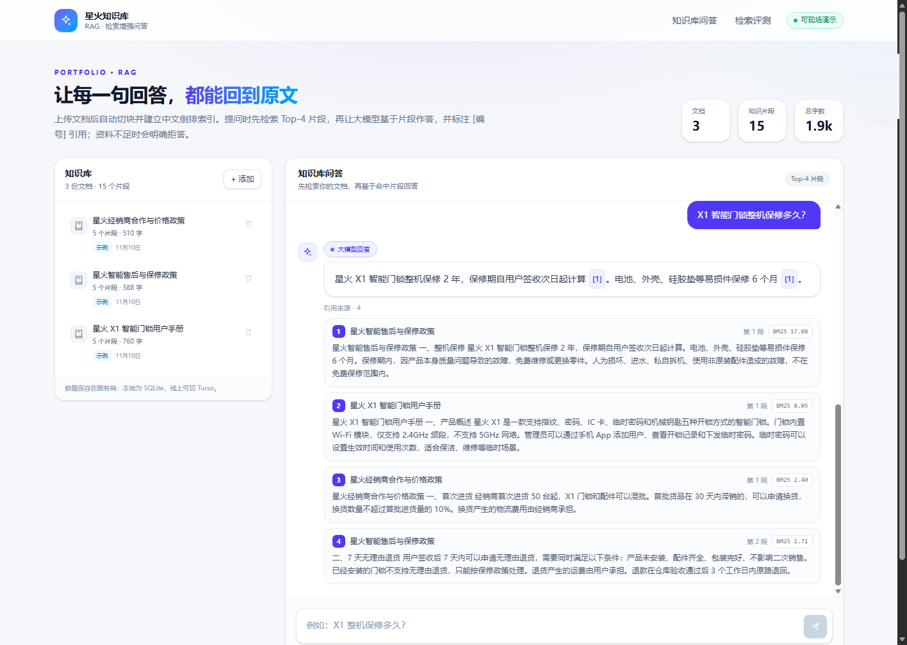
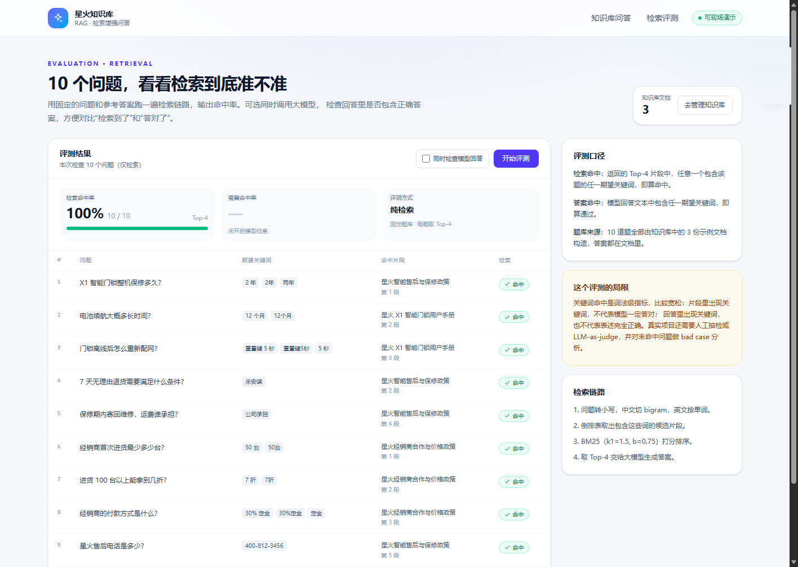

# 星火知识库 · RAG 问答

一个用于求职展示的 RAG 全栈项目：上传文档后自动切块、建立中文倒排索引；提问时先检索 Top-4 片段，再让大模型基于片段回答，并标注 `[编号]` 引用。

内置 3 份虚构的「星火智能」示例文档（产品手册、售后政策、经销商政策）和 10 题评测页，打开即可演示。





## 功能

- **知识库管理**：粘贴文本，或直接读取 `.txt` / `.md` 文件；自动切块、建索引；删除文档时连带清理片段和倒排项。
- **检索问答**：中文 bigram 分词 + BM25 排序，返回 Top-4 片段；答案带 `[n]` 引用，并展示来源文档、段号和 BM25 分数。
- **资料不足时拒答**：系统提示词要求只能使用给定片段；资料不够时明确回答「根据现有知识库无法回答」，不补充外部知识。
- **无 Key 降级**：未配置 `LLM_API_KEY` 时只返回检索结果；模型超时或报错时也自动退回检索结果，页面不会白屏。
- **检索评测**：10 道固定问题的命中率评测；可选同时调用大模型，检查回答是否包含参考答案。
- **本地 / 线上双存储**：本地用 Node 内置 `node:sqlite`，线上用 Turso；同一套表结构和 SQL。

## 技术栈

| 层 | 选型 |
| --- | --- |
| 前端 / 服务端 | Next.js 16（App Router、Route Handlers）、React 19、TypeScript |
| 样式 | Tailwind CSS 4 |
| 数据库 | 本地 `node:sqlite`；线上 Turso（libSQL） |
| 大模型 | DeepSeek Chat Completions（OpenAI 兼容接口） |
| 检索 | 自己实现的中文 bigram 倒排索引 + BM25 |

## 检索方案

### 切块

- 先按空行分段；过长的段落按句号、问号、感叹号、分号切分。
- 相邻段落合并到约 **520 字**，块间重叠 **80 字**，避免答案正好跨在切块边界。
- 遇到「一、」「二、」「第 3 章」这类小标题时另起一块，让引用能定位到具体章节；开头的短标题（文档名）会并入第一节，避免产生无意义的碎块。

### 索引

中文没有空格，这里不引入分词服务，直接用 **字符二元组（bigram）**：

```text
门锁保修  ->  门锁 / 锁保 / 保修
```

英文和数字按单词切分。每篇文档的每个片段都会写入 `chunk_terms(chunk_id, term, freq)` 倒排表，查询时用同一套规则处理问题。

### 排序

BM25，参数 `k1 = 1.5`、`b = 0.75`：

```text
idf(t) = ln(1 + (N - df + 0.5) / (df + 0.5))
score  = Σ idf(t) * freq * (k1 + 1)
         / (freq + k1 * (1 - b + b * len / avgLen))
```

取分数最高的 4 个片段作为上下文，连同问题一起发给大模型。

### 为什么不用向量检索

这是一个有意的取舍，不是「上不了向量」：

- 示例语料只有三份文档，词法检索已经够用，还能省掉 embedding 服务和额外费用；
- bigram 对型号、电话号码、政策条款这类专有词很稳，不会因为分词错误把关键词切丢；
- 整个检索链路可以在 SQLite / Turso 里完成，部署简单，冷启动快。

**已知短板**：同义词和改写句的召回较弱，比如「质保」不一定能召回「保修」。下一步可以做 BM25 + 向量混合检索、加 rerank，或用分数阈值过滤弱相关片段。评测页里也写明了关键词指标的局限。

## 数据模型

```sql
documents(id, title, source, created_at, char_count, chunk_count)
chunks(id, document_id, ordinal, text, token_count)
chunk_terms(chunk_id, term, freq)

CREATE INDEX idx_chunks_document ON chunks(document_id);
CREATE INDEX idx_chunk_terms_term ON chunk_terms(term);
```

文档 ID 和片段 ID 都是 TEXT UUID，一篇文档的「文档 + 片段 + 倒排项」可以在一个批次里写入：

- 本地：`BEGIN` / `COMMIT`，失败回滚；
- Turso：`client.batch(statements, "write")`。

## 本地运行

要求 Node.js 22.5+（`node:sqlite` 需要）。

```powershell
npm install
Copy-Item .env.example .env.local
# 编辑 .env.local，填入 LLM_API_KEY
npm run dev
```

打开 <http://localhost:3000>，点左侧「载入示例文档」，然后直接在右侧提问。

不配置 Key 也能跑：问答页会显示检索到的原文片段，只是没有模型生成的总结。

### 环境变量

| 变量 | 必填 | 说明 |
| --- | --- | --- |
| `LLM_BASE_URL` | 否 | 默认 `https://api.deepseek.com/v1` |
| `LLM_API_KEY` | 否 | 不填则自动降级为纯检索 |
| `LLM_MODEL` | 否 | 默认 `deepseek-chat` |
| `TURSO_DATABASE_URL` | 线上必填 | 填了就切换 Turso，不填用本地 SQLite |
| `TURSO_AUTH_TOKEN` | 线上必填 | Turso 访问令牌 |
| `RAG_DB_DIR` | 否 | 本地 SQLite 目录，默认项目下 `.data/` |
| `AUTO_SEED` | 否 | 设为 `1` 时空库自动载入示例，适合没有持久磁盘的演示环境 |

`.env.local` 已被 `.gitignore` 忽略，不要提交密钥。

## API

| 方法 | 路径 | 说明 |
| --- | --- | --- |
| `GET` | `/api/documents` | 文档列表 |
| `POST` | `/api/documents` | 新建文档，body：`{ title, text }` |
| `DELETE` | `/api/documents/:id` | 删除文档及其片段、倒排项 |
| `POST` | `/api/query` | 问答，body：`{ question }` |
| `POST` | `/api/seed` | 幂等载入 3 份示例文档 |
| `POST` | `/api/eval` | 评测，body：`{ withLlm?: boolean }` |

## 评测

评测页：<http://localhost:3000/eval>。默认只跑检索（几百毫秒），勾选「同时检查模型回答」会额外调用 10 次大模型。

口径：

- **检索命中**：Top-4 片段中任意一个包含该题的任一期望关键词；
- **答案命中**：模型回答包含任一期望关键词；
- 题库和示例文档同源，所以分数只反映「这个演示知识库上的检索链路是否正常」，不代表开放域效果。

当前自测结果（DeepSeek，2026-11）：检索命中 **10/10**，答案关键词命中 **10/10**。关键词匹配不等于语义完全正确，真实项目还需要人工抽检或 LLM-as-judge。

## 部署到 Render + Turso

仓库根目录带了 `render.yaml`，也可以在 Render 里用 Blueprint 一键创建。

1. 在 Turso 新建数据库，拿到 `libsql://...` 地址和 token。
2. Render 新建 Web Service（或 Blueprint），连接仓库。
3. Build Command：`npm install && npm run build`
4. Start Command：`npm run start -- -p $PORT`
5. 环境变量填 `LLM_BASE_URL`、`LLM_API_KEY`、`LLM_MODEL`、`TURSO_DATABASE_URL`、`TURSO_AUTH_TOKEN`。
6. 部署完成后打开站点，点「载入示例文档」。Turso 中的数据会持久保存。

Render 免费实例 15 分钟无请求会休眠，面试演示前先自己打开一次，等 30–60 秒唤醒。

## 目录结构

```text
app/
  api/
    documents/route.ts       文档列表 / 新建
    documents/[id]/route.ts  删除文档
    query/route.ts           检索 + 生成回答
    seed/route.ts            载入示例
    eval/route.ts            10 题评测
  eval/page.tsx              评测页
  page.tsx                   问答页
  layout.tsx                 全局布局
  globals.css
lib/
  chunk.ts                   文本规范化、bigram 分词、切块
  db.ts                      SQLite / Turso 适配
  store.ts                   文档 CRUD、倒排项、语料统计
  retrieve.ts                BM25 检索
  answer.ts                  提示词、模型调用、降级
  samples.ts                 示例文档与题库
  types.ts                   共享类型
```

## 已知限制

- 词法检索对同义词、口语化改写不友好；
- 没有做用户体系和权限，任何访问者都能增删文档；
- 示例文档是虚构内容，仅用于演示；
- 评测是关键词级快速检查，不是严格的 RAG 评测。
